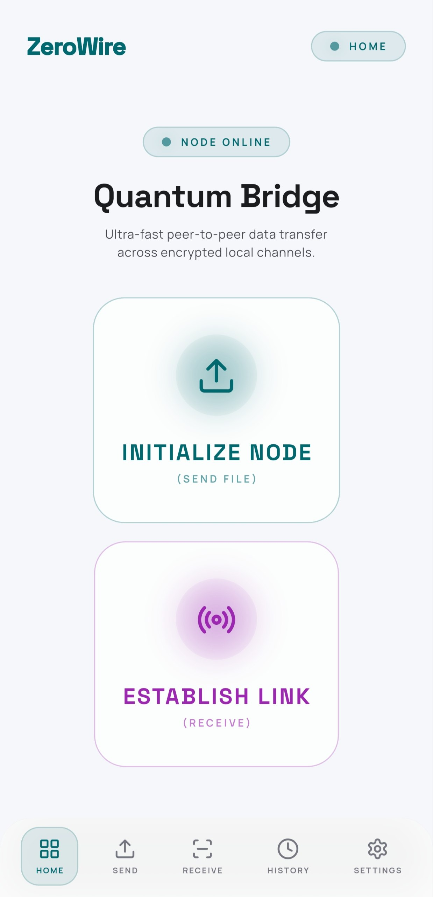
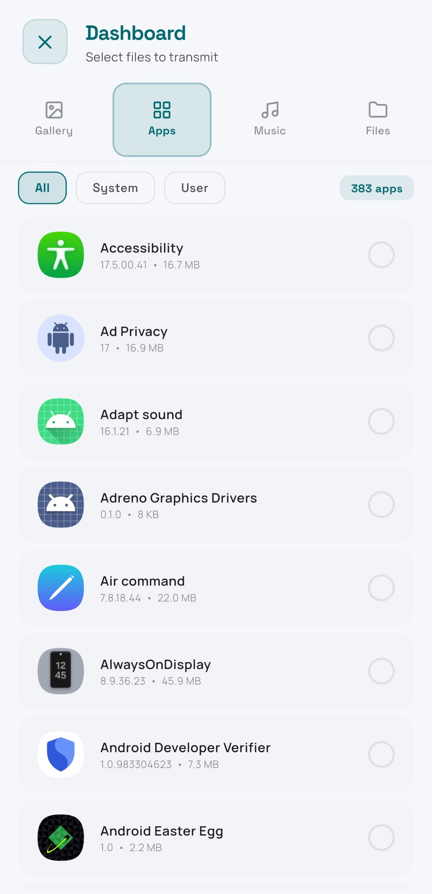
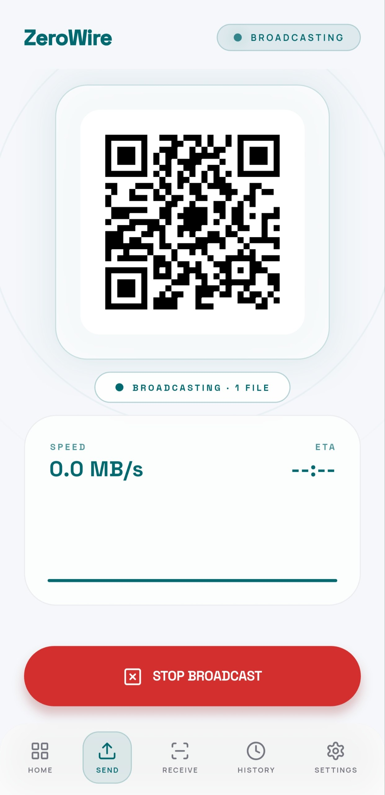
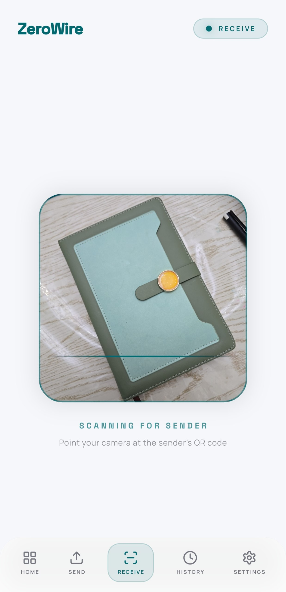

# ZeroWire

[](https://play.google.com/store/apps/details?id=com.msma.zerowire)
[](https://flutter.dev)
[](https://flutter.dev)
[](LICENSE)

ZeroWire is an offline, peer-to-peer file transfer app for Android built with Flutter. It lets two devices send files over local Wi-Fi or hotspot connections at full network hardware speed, without cellular data, cloud servers, or file size caps.

---

## Screenshots

<p align="center">
  
  
  
  
</p>

<p align="center">
  <sub><b>From left to right:</b> (1) Home dashboard, (2) Categorized media & installed APK picker, (3) Sender broadcast & telemetry view, (4) QR code scanner receiver flow.</sub>
</p>

---

## Why I Built This

Most file sharing tools either route your files through external cloud relays, throttle transfer speeds, or bombard you with ads. ZeroWire runs directly over the local network:

- **Direct socket pipeline:** Throughput is bounded only by your Wi-Fi router or hotspot bandwidth (typically 30–50+ MB/s).
- **Private by design:** Traffic never leaves your local subnet. No accounts, no tracking, no external server infrastructure.
- **Low memory footprint:** Multi-gigabyte videos and batches of APKs are streamed chunk-by-chunk directly off storage rather than buffered into RAM.

---

## How It Works

```
[ Sender ]                                            [ Receiver ]
    │                                                      │
    │  ◀─────── UDP Broadcast Beacon (Port 41234) ─────────│  (Radar mode)
    │                                                      │
    │  ── OR ────────────────────────────────────────────  │
    │                                                      │
    │  ──────── Scans Dynamic QR Code on Sender ─────────▶ │  (Fallback)
    │                                                      │
    │  ◀─────── GET /info (File list & byte lengths) ──────│
    │  ──────── 200 OK [JSON metadata] ──────────────────▶ │
    │                                                      │
    │  ◀─────── GET /download/{index} (Binary Stream) ─────│
    │  ──────── Chunked Octet-Stream ────────────────────▶ │  (Writes directly to disk)
    │                                                      │
```

### 1. Zero-Config Discovery (UDP Radar)
When the receiver opens the app, it broadcasts lightweight presence beacons (`ZEROWIRE_V1|RECEIVER|<DeviceName>|<Port>`) over UDP port `41234` every 2 seconds. The sender listens for these datagrams, resolves the sender's IP address, and automatically updates the active device radar list. Devices that go offline are pruned after an 8-second timeout.

### 2. QR Code Pairing Fallback
On public Wi-Fi networks where Client Isolation (AP Isolation) blocks UDP multicast between devices, the sender generates a dynamic QR code containing its local IP and allocated port. The receiver scans this using `mobile_scanner` to connect immediately.

### 3. Chunked HTTP Streaming
The sender spins up an embedded HTTP server using Dart's `shelf` package on a dynamic local port. 
- Files are requested sequentially via `/download/{index}`.
- Data is piped using a `StreamTransformer<List<int>, List<int>>` directly from disk into the HTTP response stream.
- The receiver writes incoming bytes directly to the downloads directory using `Dio`, keeping memory consumption constant regardless of file size.

### 4. Real-Time Telemetry
Both sender and receiver run a sliding 500ms sampling window to track exact transferred byte deltas. This feeds:
- Live transfer speed in MB/s
- Dynamic ETA estimation
- A rolling 30-tick transfer chart plotted via `fl_chart`

### 5. Native Android Integrations
- **App Extractor:** Uses `device_apps` to list user and system applications and extract their base APKs for transfer.
- **Media Querying:** Queries photo, video, and audio stores on-device without third-party file pickers.
- **Media Scanner:** Runs Android's `MediaScannerConnection` right after receipt so images, songs, and videos show up instantly in the native gallery and file manager.

---

## Tech Stack

- **Framework:** Flutter (Dart 3.x)
- **Embedded Server:** `shelf`, `shelf_router`, `shelf_io`
- **HTTP Client:** `dio`
- **Network & Discovery:** `dart:io` (`RawDatagramSocket`), `network_info_plus`
- **QR Engine:** `qr_flutter`, `mobile_scanner`
- **State Management:** `provider`
- **Visuals & Charts:** `fl_chart`, `lucide_icons`, `google_fonts`
- **OS Integrations:** `device_apps`, `photo_manager`, `on_audio_query`, `media_scanner`

---

## Getting Started

### Prerequisites
- [Flutter SDK](https://docs.flutter.dev/get-started/install) (>= 3.10.0)
- Android SDK (target API 34+)
- Two physical Android devices (or one device + Android emulator connected to the same Wi-Fi / hotspot network)

### Setup & Run

1. Clone the repository:
   ```bash
   git clone https://github.com/m-yakubov/zerowire.git
   cd zerowire
   ```

2. Fetch Flutter packages:
   ```bash
   flutter pub get
   ```

3. Connect your Android device via USB and run:
   ```bash
   flutter run
   ```

4. Build release APK:
   ```bash
   flutter build apk --release
   ```
   The APK output will be located at `build/app/outputs/flutter-apk/app-release.apk`.

---

## Authors & Collaborators

- **Muhammadali Yakubov** — Core architecture, embedded streaming server, and UI implementation ([GitHub](https://github.com/m-yakubov))
- **Muhammadsodiq Umrzoqov** — Networking protocol, P2P discovery optimization, and testing

---

## License

This project is licensed under the MIT License. See [LICENSE](LICENSE) for details.
